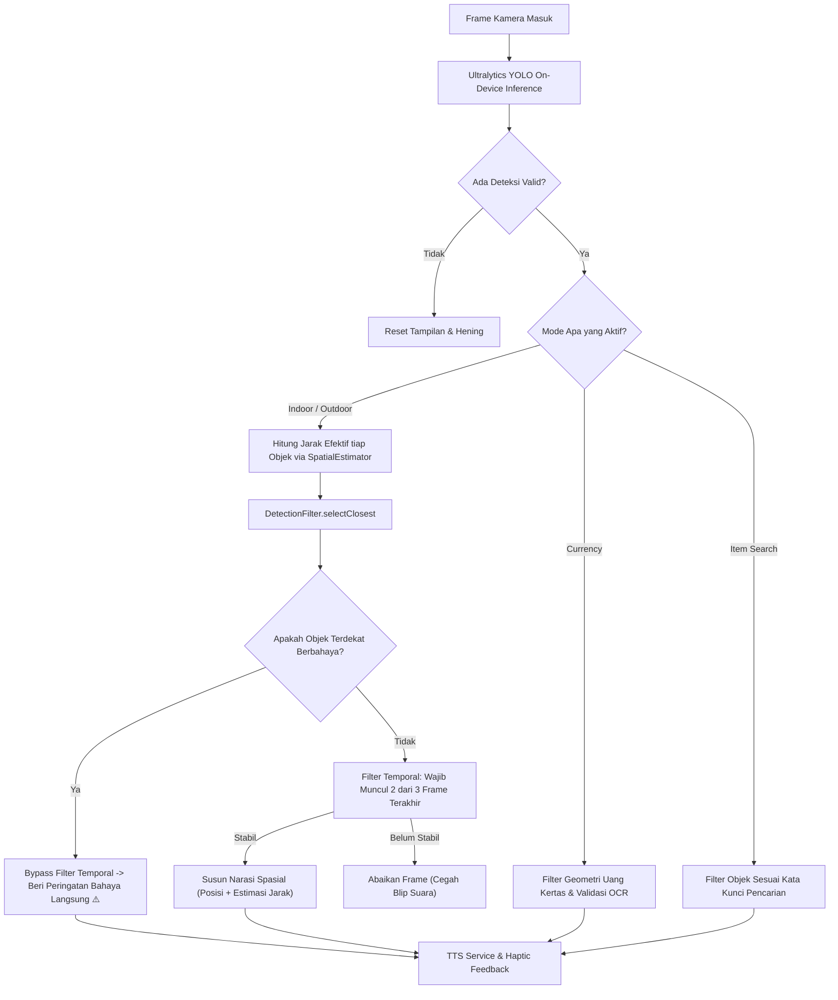
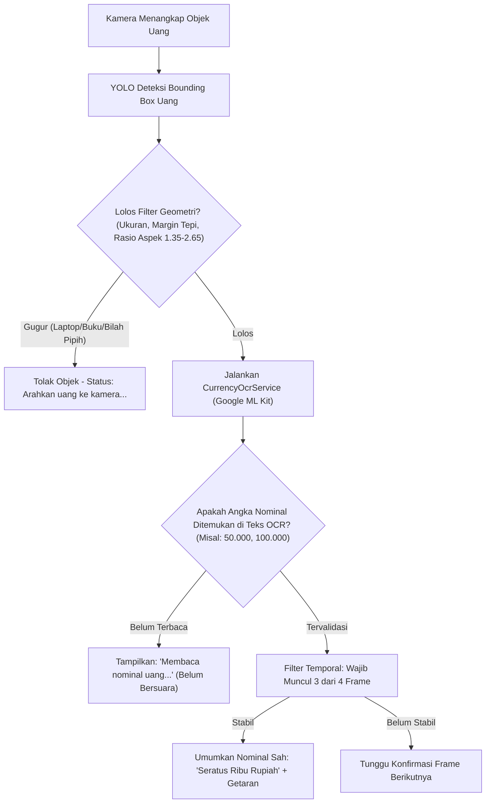
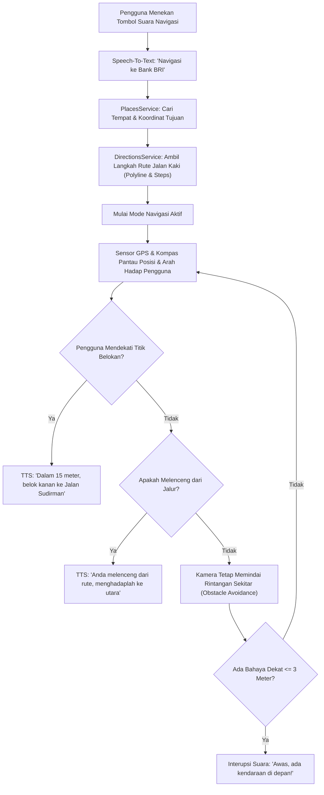

# NetraVision (NetraVision Apps) 👁️🚶‍♂️

> **Asisten Cerdas Mobilitas dan Penglihatan Mandiri Tunanetra Berbasis Edge AI & Computer Vision**

NetraVision adalah aplikasi *mobile* cerdas berbasis Flutter yang dirancang khusus untuk meningkatkan kemandirian, keselamatan, dan mobilitas penyandang disabilitas netra (tunanetra). Aplikasi ini mengintegrasikan **Computer Vision On-Device (Ultralytics YOLO LiteRT)**, **Google ML Kit OCR**, **Google Maps Directions & Places API**, **Spatial Audio Guidance**, serta **WebRTC Live Visual Assistance** dengan antarmuka yang 100% ramah aksesibilitas (*A11y First*).

---

## 📑 Daftar Isi
1. [Fitur Utama](#-fitur-utama)
2. [Arsitektur Sistem & Perangkat Lunak](#-arsitektur-sistem--perangkat-lunak)
3. [Diagram Alur Kerja (Flowcharts)](#-diagram-alur-kerja-flowcharts)
   - [Alur Deteksi Objek & Panduan Suara](#1-alur-deteksi-objek--panduan-spasial)
   - [Alur Mode Baca Uang & Validasi OCR](#2-alur-mode-baca-uang-rupiah--validasi-ocr)
   - [Alur Navigasi Pejalan Kaki Luar Ruangan](#3-alur-navigasi-pejalan-kaki-luar-ruangan)
4. [Komponen Inti & Cara Kerja Algoritma](#-komponen-inti--cara-kerja-algoritma)
5. [Panduan Instalasi APK (Solusi Google Play Protect)](#-panduan-instalasi-apk-mengatasi-google-play-protect)
6. [Panduan Build & Menjalankan dari Source Code](#-panduan-build--menjalankan-dari-source-code)
7. [Struktur Direktori Proyek](#-struktur-direktori-proyek)

---

## 🌟 Fitur Utama

### 1. 🏠 Mode Dalam Ruangan (Indoor Mode)
- **Deteksi Rintangan & Perabotan:** Mendeteksi kursi, meja, tempat tidur, pintu, wastafel, tangga, dan objek ruangan lainnya menggunakan model YOLO Edge AI.
- **Prioritas Objek Terdekat (`selectClosest`):** Memprioritaskan rintangan yang tepat berada di depan langkah kaki pengguna (misal kursi 0,8m) agar pengguna tidak menabrak rintangan langsung.
- **Estimasi Spasial & Jarak:** Mengumumkan orientasi posisi (`depan`, `kiri`, `kanan`) dan perkiraan jarak dalam meter secara real-time.

### 2. 🛣️ Mode Luar Ruangan & Navigasi (Outdoor Mode & Navigation)
- **Deteksi Bahaya Jalan:** Mengenali kendaraan (mobil, motor, bus, truk), orang, tiang, lubang, dan pohon.
- **Peringatan Keselamatan Instan:** Objek berbahaya langsung memicu status bahaya (`⚠️`), getaran haptic kuat, dan suara peringatan tanpa jeda temporal.
- **Navigasi Belokan Demi Belokan (Turn-by-Turn Walk):** Pengguna cukup menyebutkan tujuan via input suara, sistem menghitung rute pedestrian via Google Directions API dan memandu arah langkah dengan kompas perangkat.

### 3. 💵 Mode Baca Uang Rupiah (Currency Reader)
- **Deteksi Nominal Uang Kertas & Logam:** Mengenali pecahan Rp1.000 s/d Rp100.000.
- **Filter Geometri Bank Indonesia:** Memvalidasi rasio aspek fisik uang kertas asli (rasio 1.35 s/d 2.65) dan bentuk bulat koin, serta menolak objek bujur sangkar (layar laptop, buku, touchpad).
- **Verifikasi Angka Nominal On-Device (Google ML Kit OCR):** Model YOLO hanya membaca nominal setelah sistem berhasil memvalidasi teks angka nominal pada fisik uang via OCR, mencegah pembacaan nominal palsu (*false positive*).

### 4. 🔍 Mode Cari Barang (Item Search)
- **Pencarian Berbasis Suara (STT):** Pengguna menekan tombol atau layar dan menyebutkan barang yang dicari (misal: "cari botol", "ponsel", "kunci").
- **Panduan Suara & Haptic Sonar:** Frekuensi getaran dan pengumuman arah suara akan meningkat semakin dekat kamera mengarah ke barang tersebut.

### 5. 🤝 Bantuan Visual Relawan (Visual Help via LiveKit)
- **Panggilan Video Relawan Low-Latency:** Menghubungkan tunanetra dengan relawan terpercaya atau keluarga melalui video call WebRTC terenkripsi (LiveKit Client SDK) saat membutuhkan bantuan pandangan manusia.
- **Daftar Kontak Tepercaya:** Manajemen kontak keluarga/relawan yang tersimpan aman secara lokal.

### 6. 🆘 Darurat SOS & Layanan Aksesibilitas Native
- **Pengiriman Pesan Darurat Otomatis:** Mengirim titik koordinat GPS akurat dan pesan bahaya langsung ke nomor darurat via WhatsApp atau SMS.
- **NetraAccessibilityService:** Layanan aksesibilitas native Android untuk otomatisasi penekanan tombol kirim/panggilan darurat bagi tunanetra.

---

## 🏗️ Arsitektur Sistem & Perangkat Lunak

NetraVision dibangun dengan prinsip **Clean Architecture** yang dipadukan dengan **GetX State Management**:

```mermaid
graph TD
    subgraph UI_Layer["1. UI & Interaction Layer (Views & Widgets)"]
        HV[HomeView]
        DV[DetectorView]
        IV[ItemSearchView]
        VHV[VisualHelpView]
        BBO[BoundingBoxOverlay]
        NME[NavigationMapEmbed]
    end

    subgraph Controller_Layer["2. Business Logic Layer (GetX Controllers)"]
        HC[HomeController]
        DC[DetectorController]
        ISC[ItemSearchController]
        VHC[VisualHelpController]
    end

    subgraph Service_Layer["3. Service & Sensor Layer"]
        TTS[TtsService - Suara Bahasa Indonesia]
        VIB[VibrationService - Haptic Feedback]
        LOC[LocationService - GPS Geolocator]
        COMP[CompassService - Heading & Orientasi]
        DIR[DirectionsService - Google Directions API]
        PLC[PlacesService - Google Places API]
        OCR[CurrencyOcrService - Google ML Kit]
        LKIT[LiveKitCallService - WebRTC Video Call]
        ACC[AutoClickService / NetraAccessibilityService]
    end

    subgraph Engine_Layer["4. AI & Core Computational Layer"]
        YOLO["Ultralytics YOLO LiteRT Engine (TFLite)"]
        DF["DetectionFilter (Temporal, Spatial & Geometry Filter)"]
        SE["SpatialEstimator (Estimasi Jarak & Zona Spasial)"]
        OSH["ObjectSpeechHelper (Labeling & Terjemahan Suara)"]
        TTSP["TtsPolicy & DangerSpeechPolicy (Gating Ucapan)"]
    end

    UI_Layer --> Controller_Layer
    Controller_Layer --> Service_Layer
    Controller_Layer --> Engine_Layer
    Service_Layer --> Engine_Layer
```



---

## 🔄 Diagram Alur Kerja (Flowcharts)

### 1. Alur Deteksi Objek & Panduan Spasial


---

### 2. Alur Mode Baca Uang Rupiah & Validasi OCR


---

### 3. Alur Navigasi Pejalan Kaki Luar Ruangan


---

## 🧠 Komponen Inti & Cara Kerja Algoritma

### 1. `SpatialEstimator` ([`spatial_estimator.dart`](lib/app/utils/helpers/spatial_estimator.dart))
Mengubah koordinat 2D bounding box kamera (`normalizedBox`) menjadi representasi spasial 3D:
- **Zona Horizontal:** `kiri` ($c_x < 0.35$), `depan` ($0.35 \le c_x \le 0.65$), `kanan` ($c_x > 0.65$).
- **Estimasi Jarak Meter:** Menggunakan trigonometri sudut pandang kamera ponsel (asumsi horizontal FOV $\approx 65^\circ$) dan referensi lebar fisik objek:
  $$\text{jarak} = \frac{\text{lebarFisikReferensi}}{2 \times \tan\left(\frac{1}{2} \times \text{FOV} \times \text{lebarBox}\right)}$$
- Dilengkapi mekanisme fallback berbasis akar kuadrat fraksi area jika lebar kelas tidak memiliki referensi eksplisit: $\text{jarak} = \sqrt{\frac{0.128}{\text{area}}}$.

### 2. `DetectionFilter` ([`detection_filter.dart`](lib/app/utils/helpers/detection_filter.dart))
- **`selectClosest` (Prioritas Jarak):** Menghitung jarak efektif semua objek. Mengelompokkan objek dalam klaster jarak terdekat (ambang toleransi $\le 0.6$ meter). Rintangan jauh di latar belakang (misal mobil di seberang jendela) dieliminasi sehingga tidak menimpa rintangan dekat (misal kursi/meja di depan kaki).
- **`isStable` (Filter Temporal):** Mewajibkan kelas deteksi yang sama muncul secara konsisten (2 dari 3 frame untuk indoor/outdoor, dan 3 dari 4 frame untuk baca uang) untuk mengeliminasi gangguan sesaat (*flickering*).

### 3. Kebijakan Suara & Bahaya (`TTSPolicy` & `DangerSpeechPolicy`)
- Mengatur *cooldown* pengumuman agar suara TTS tidak saling tumpang tindih (*chatter reduction*).
- Objek dengan klasifikasi bahaya (`mobil`, `sepeda motor`, `truk`, `lubang`, dll.) memiliki prioritas tinggi yang dapat menginterupsi suara yang sedang berjalan demi keselamatan tunanetra.

---

## 📲 Panduan Instalasi APK (Mengatasi Google Play Protect)

Saat memasang file `app-release.apk` hasil build di HP Android (terutama jika file dikirim melalui **WhatsApp**, **Telegram**, atau diunduh via **Browser**), Anda mungkin menjumpai jendela peringatan Google Play Protect:

> **"Aplikasi diblokir untuk melindungi perangkat Anda"**  
> *"Aplikasi ini dapat meminta akses ke data sensitif. Hal ini dapat meningkatkan risiko pencurian identitas atau penipuan keuangan."* (Hanya ada tombol **Oke**).

### Mengapa Hal Ini Terjadi?
Sistem keamanan Android (terutama di Indonesia) secara otomatis memblokir APK dari aplikasi perpesanan/browser jika meminta izin:
1. **Layanan Aksesibilitas (`BIND_ACCESSIBILITY_SERVICE`)**: Digunakan NetraVision untuk fitur auto-klik panggilan darurat tunanetra.
2. **Membaca Kontak (`READ_CONTACTS`)**: Digunakan untuk memilih kontak darurat SOS.

---

### Solusi Cepat: Matikan Sementara Google Play Protect di HP

Ikuti langkah-langkah mudah berikut untuk menginstal aplikasi:

1. **Buka Aplikasi Google Play Store** di ponsel Anda.
2. **Ketuk Ikon Foto Profil** Anda di pojok kanan atas.
3. **Pilih Menu "Play Protect"**.
4. **Ketuk Ikon Pengaturan / Gerigi (⚙️)** di pojok kanan atas layar Play Protect.
5. **Nonaktifkan / Matikan Opsi:**
   - 🔴 **Pindai aplikasi dengan Play Protect** *(Scan apps with Play Protect)*.
6. Saat muncul jendela konfirmasi, pilih **"Nonaktifkan" / "Matikan"**.
7. Sekarang, buka kembali file `app-release.apk` Anda (di WhatsApp atau File Manager). Tekan **Install**, dan aplikasi NetraVision akan langsung terpasang dengan sukses!
8. *(Opsional)* Setelah aplikasi berhasil dipasang dan digunakan, Anda dapat mengaktifkan kembali Play Protect di Play Store jika diinginkan.

---

### Solusi Alternatif: Instalasi via Komputer / Laptop (Kabel USB)
Jika Anda memiliki laptop dengan koneksi kabel data (USB Debugging aktif):
```bash
adb install -r build/app/outputs/flutter-apk/app-release.apk
```
Instalasi melalui ADB tidak akan pernah diblokir oleh Google Play Protect.

---

## 💻 Panduan Build & Menjalankan dari Source Code

### Prasyarat Lingkungan
- **Flutter SDK:** Version `^3.13.4` atau terbaru
- **Dart SDK:** Version `^3.13.4`
- **Android SDK:** `compileSdk = 36`, `targetSdk = 36`, `minSdk = 23`
- **Java JDK:** OpenJDK 17

### 1. Klon Repositori
```bash
git clone https://github.com/username/netravisionapps.git
cd netravisionapps
```

### 2. Pasang Dependensi
```bash
flutter pub get
```

### 3. Konfigurasi Environment & Kunci API
Buat file `.env` di root direktori proyek:
```env
GOOGLE_MAPS_API_KEY=AIzaSyYourGoogleMapsApiKeyHere
LIVEKIT_URL=wss://your-livekit-server.com
LIVEKIT_API_KEY=your_livekit_api_key
LIVEKIT_API_SECRET=your_livekit_api_secret
```

### 4. Konfigurasi Keystore Signing (Rilis)
Buat file `android/key.properties`:
```properties
storePassword=password_keystore_anda
keyPassword=password_key_anda
keyAlias=upload
storeFile=/path/ke/upload-keystore.jks
```

### 5. Jalankan Pengujian Unit
```bash
flutter test
```

### 6. Build APK Rilis
```bash
flutter build apk --release
```
File APK siap instal akan tersedia di:
`build/app/outputs/flutter-apk/app-release.apk`

---

## 📁 Struktur Direktori Proyek

```text
netravisionapps/
├── android/                        # Konfigurasi Native Android & Gradle
│   ├── app/
│   │   ├── build.gradle.kts        # Signing config & targetSdk 36
│   │   └── src/main/
│   │       ├── AndroidManifest.xml # Izin kamera, audio, GPS, aksesibilitas
│   │       └── kotlin/...          # NetraAccessibilityService & MainActivity
│   └── key.properties              # Konfigurasi rahasia keystore (diabaikan Git)
├── assets/
│   ├── images/                     # Aset logo aplikasi NetraVision
│   └── models/                     # Model AI Edge On-Device (TFLite)
│       ├── indoor/                 # Model objek dalam ruangan & label
│       ├── outdoor/                # Model rintangan jalan, trotoar & label
│       └── rupiah/                 # Model deteksi pecahan uang rupiah
├── lib/
│   ├── app/
│   │   ├── config/                 # Konfigurasi aplikasi & konstanta
│   │   ├── data/models/            # Data models (VisionMode, Navigation, dll.)
│   │   ├── modules/                # Pola GetX (Bindings, Controllers, Views)
│   │   │   ├── detector/           # Modul Deteksi Kamera YOLO
│   │   │   ├── home/               # Modul Beranda Aksesibel
│   │   │   ├── item_search/        # Modul Pencarian Barang Suara
│   │   │   ├── splash/             # Modul Splash Screen
│   │   │   └── visual_help/        # Modul Bantuan Relawan WebRTC LiveKit
│   │   ├── routes/                 # Routing GetPages & Route Names
│   │   ├── services/               # Layanan Hardware, Sensor, API & TTS
│   │   └── utils/helpers/          # SpatialEstimator, DetectionFilter, OCR, GeoMath
│   └── main.dart                   # Entry point aplikasi & inisialisasi modul
├── test/                           # Unit tests & algorithmic validation
├── pubspec.yaml                    # Dependensi paket Flutter & deklarasi aset
└── README.md                       # Dokumentasi resmi proyek NetraVision
```

---

<p align="center">
  Dibuat dengan ❤️ untuk inklusivitas dan kemandirian penyandang disabilitas netra.
</p>
