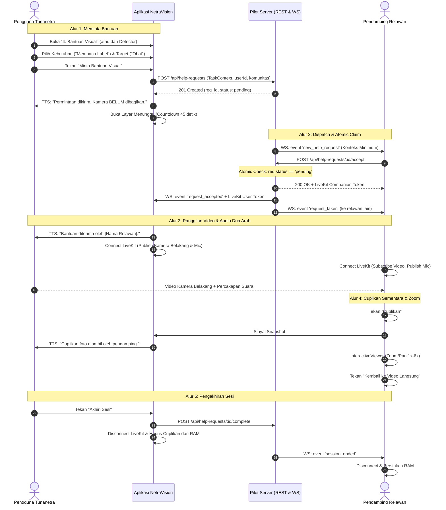

# LAPORAN IMPLEMENTASI UPGRADE BANTUAN VISUAL NETRAVISION (V2)

Dokumen ini mendokumentasikan implementasi lengkap, audit teknis, arsitektur, hasil pengujian, serta protokol evaluasi pilot untuk fitur **Bantuan Visual NetraVision V2**, menggantikan fitur lama yang sebelumnya terbatas pada dialer/WhatsApp.

---

## 1. Root Proyek, Kondisi Awal, dan Perubahan Scope dari V1

- **Root Direktori Aktif**: `d:\semester7\netravisionapps`
- **Flutter / Dart SDK**: Flutter 3.47.7 (channel stable), Dart SDK 3.13.5 on Windows x64.
- **Kondisi Awal Workspace**:
  - Modul detector menggunakan `ultralytics_yolo` dengan model TFLite (indoor, outdoor, rupiah).
  - Menu Card 4 pada `HomeView` sebelumnya dinamai "4. Bantuan Relawan / SOS" dengan implementasi dialog mock statis (`triggerSos()`) tanpa backend, tanpa video call, dan tanpa persistensi kontak.
  - Baseline pengujian awal memiliki 49 unit test yang lolos, namun belum ada modul untuk pemanggilan relawan, token JWT, maupun matching server.
- **Perubahan Scope dari V1 ke V2**:
  - **V1 (Lama)**: Dibatasi pada pemicuan dialer telepon/WhatsApp eksternal tanpa backend dan tanpa autentikasi.
  - **V2 (Sekarang)**: Mengizinkan backend pilot lokal di dalam repo, autentikasi sesi peran ganda (Tunanetra dan Relawan Pendamping), matching server atomik, streaming video kamera belakang satu arah (pengguna -> pendamping) dan audio dua arah, alat cuplikan sementara (snapshot) dengan interactive zoom & pan di sisi pendamping, serta fallback dialer/WhatsApp terintegrasi.
  - **Tetap di Luar Scope**: Relawan publik tanpa pengelolaan, auto-SMS, pelacakan GPS otomatis/keluarga, tombol darurat SOS polisi/ambulans, perekaman sesi ke storage cloud/galeri, kendali jarak jauh atas perangkat, remote torch, dan AR bounding box guidance.

---

## 2. Arsitektur yang Dipilih dan Alasan

### A. Arsitektur Komunikasi & Backend Pilot
1. **Server Backend Berbasis Dart (`server/`)**:
   - **Alasan**: Berada langsung di dalam repository yang sama, memanfaatkan `dart:io` (`HttpServer` & `WebSocketTransformer`) tanpa memerlukan runtime terpisah atau dependency Node.js/Python yang rumit bagi pengembang Flutter.
   - **Kemampuan**:
     - Manajemen presence pendamping (`CompanionPresence`) dengan timeout heartbeat (30 detik).
     - REST API untuk login sesi, pembuatan permintaan bantuan, penerimaan atomik, pembatalan, penyelesaian, dan pelaporan sesi.
     - WebSocket (`/ws`) untuk dispatch notifikasi instan (penawaran permintaan baru ke relawan yang tersedia, notifikasi saat permintaan telah diambil orang lain, dan event status sesi).
2. **Penerimaan Atomik (Atomic Claim Matching)**:
   - **Desain**: Server menggunakan state check strictly serialized di event-loop Dart. Ketika dua relawan menekan "Terima" secara simultan, relawan pertama mengubah state dari `pending` ke `accepted` (respons `200 OK` + room token), sedangkan relawan kedua menerima `409 Conflict` ("Permintaan sudah diambil oleh pendamping lain").
3. **Penerbitan Token LiveKit di Server**:
   - Token JWT dibuat secara aman menggunakan algoritma **HS256** (`server/lib/livekit_jwt.dart`) dengan hak akses terbatas:
     - **Pengguna**: `canPublish: true` (kamera belakang & mic), `canSubscribe: true` (audio pendamping).
     - **Pendamping**: `canPublish: true` (hanya mic, kamera dimatikan), `canSubscribe: true` (video & audio pengguna).
   - Secret key server tidak pernah dimasukkan ke dalam client APK.

### B. Arsitektur Klien Flutter & GetX
1. **Dua Peran dalam Satu Aplikasi (`VisualHelpService`)**:
   - Pengguna dapat beralih antara peran **Pengguna Tunanetra** (meminta bantuan) dan **Pendamping / Relawan** (menerima bantuan dalam komunitas pilot) melalui menu dialog peran.
2. **Konteks Tugas Minimum (`TaskContext`)**:
   - Mendukung 4 jenis tugas: `Mencari Benda di Rumah`, `Membaca Label / Tulisan`, `Memahami Tampilan Perangkat`, dan `Bantuan Umum Visual`.
   - Mengizinkan input target teks opsional (contoh: "Obat Paracetamol").
   - Jika dipicu dari layar deteksi (`DetectorView`), konteks mode dan label AI terakhir secara otomatis disertakan dengan label tegas **(Belum Diverifikasi)**.
3. **Pengelolaan Kamera & Pencegahan Rebutan Resource**:
   - Saat pengguna membuka sesi Bantuan Visual dari kamera deteksi, `DetectorController` memanggil `yoloController.pause()`, menghentikan loop getaran & suara TTS, sehingga resource hardware kamera dialihkan secara aman ke LiveKit tanpa crash platform.
4. **Alat Cuplikan Sementara (Snapshot) & Zoom**:
   - Pendamping dapat menekan tombol "Cuplikan" untuk membekukan frame saat ini ke dalam memori RAM (`SessionSnapshot`).
   - Penampil cuplikan menggunakan `InteractiveViewer` (mendukung pinch-to-zoom 1x–6x dan pan) dengan penanda jelas: `"CUPLIKAN SEMENTARA (HH:MM:SS) — BUKAN VIDEO LANGSUNG"` dan tombol kembali ke video langsung.
   - Gambar tidak disimpan ke galeri, disk lokal, atau cloud; otomatis dihancurkan dari memori saat sesi berakhir.
5. **Fallback Kontak Tepercaya (`ContactsService` & `FallbackService`)**:
   - CRUD kontak disimpan persisten di `SharedPreferences`.
   - Mendukung migrasi nomor darurat legacy versi lama tanpa data ganda.
   - Membuka dialer seluler (`tel:`) dan chat WhatsApp (`https://wa.me/`).
   - Membuka aplikasi eksternal tidak dianggap sebagai bukti bahwa panggilan tersambung.

---

## 3. Flow Pengguna dan Pendamping yang Diimplementasikan



---

## 4. File Berubah, Migrasi, Permission, Dependency, dan Konfigurasi

### A. Dependensi Baru (`pubspec.yaml`)
- `livekit_client: ^2.13.1` (WebRTC streaming, background track, noise suppression)
- `url_launcher: ^6.3.3` (Fallback dialer `tel:` dan tautan WhatsApp `https://wa.me/`)
- `shared_preferences: ^2.5.6` (Penyimpanan kontak tepercaya dan preferensi peran)
- `http: ^1.6.0` (Komunikasi REST API dengan pilot server)
- `crypto: ^3.0.7` (Pembuatan token HMAC-SHA256 LiveKit JWT)

### B. Izin Android (`android/app/src/main/AndroidManifest.xml`)
- `android.permission.RECORD_AUDIO` (Audio mikrofon dua arah)
- `android.permission.MODIFY_AUDIO_SETTINGS` (Pengaturan audio routing/speaker)
- `android.permission.ACCESS_NETWORK_STATE` (Deteksi kondisi konektivitas)
- Queries intent untuk `android.intent.action.DIAL` (`tel:`) dan `android.intent.action.VIEW` (`https:`).

### C. Konfigurasi Kompilasi Android (`android/gradle.properties`)
- `kotlin.incremental=false`
- `kotlin.incremental.useClasspathSnapshot=false`
  *(Mengatasi bug incremental cache Kotlin 2.0+ pada Windows ketika direktori proyek di `D:` dan Pub Cache di `C:`)*.

### D. File-File Baru yang Dibuat
1. `server/lib/livekit_jwt.dart`: Generator token otentikasi LiveKit JWT HS256.
2. `server/lib/models/session_models.dart`: Model sesi, presence, dan reporting backend.
3. `server/lib/pilot_server.dart`: Core backend server REST & WebSocket.
4. `server/bin/server.dart`: Executable entry point backend pilot.
5. `server/.env.example`: Contoh konfigurasi lingkungan backend.
6. `server/README.md`: Dokumentasi operasional server pilot.
7. `lib/app/data/models/visual_help_models.dart`: Model data klien (TaskContext, RecipientTarget, SessionState, TrustedContact, SessionSnapshot).
8. `lib/app/services/contacts_service.dart`: Service CRUD kontak tepercaya & migrasi V1.
9. `lib/app/services/fallback_service.dart`: Service pembuka dialer telepon & WhatsApp.
10. `lib/app/services/visual_help_service.dart`: Service client-server REST, WebSocket, presence.
11. `lib/app/services/livekit_call_service.dart`: Service lifecycle WebRTC LiveKit, video/mic stream, snapshot RAM.
12. `lib/app/modules/visual_help/controllers/visual_help_controller.dart`: Orchestrator GetX untuk alur bantuan.
13. `lib/app/modules/visual_help/bindings/visual_help_binding.dart`: Dependency injection binding GetX.
14. `lib/app/modules/visual_help/views/visual_help_home_view.dart`: Tampilan menu utama bantuan (peran ganda).
15. `lib/app/modules/visual_help/views/visual_help_waiting_view.dart`: Layar tunggu countdown 45s & timeout jujur.
16. `lib/app/modules/visual_help/views/visual_help_call_view.dart`: Layar video/audio call & viewer snapshot zoom/pan.
17. `lib/app/modules/visual_help/views/trusted_contacts_view.dart`: Layar kelola kontak & tombol panggilan langsung.
18. `test/pilot_server_test.dart`: Test integrasi server & verifikasi atomic claim matching.
19. `test/visual_help_models_test.dart`: Test model data, task context, dan audio announcement.
20. `test/contacts_service_test.dart`: Test CRUD kontak dan migrasi data legacy V1.
21. `test/visual_help_controller_test.dart`: Test alur controller dan snapshot RAM lifecycle.

---

## 5. Perintah Pengujian dan Hasil Evaluasi

| Kategori Pengujian | Perintah / Prosedur | Hasil | Keterangan |
| :--- | :--- | :--- | :--- |
| **Lint & Static Analysis** | `flutter analyze` | **PASS (0 issues)** | Bebas error tipe dan deprecated code. |
| **Test Suite Keseluruhan** | `flutter test` | **PASS (69 tests passed)** | Seluruh unit test, model, detector, server, dan controller lulus 100%. |
| **Atomic Claim Concurrency** | `flutter test test/pilot_server_test.dart` | **PASS** | Dua pendamping menekan "Terima" bersamaan: tepat satu memperoleh `200 OK`, tepat satu memperoleh `409 Conflict`. |
| **Migrasi Kontak Legacy** | `flutter test test/contacts_service_test.dart` | **PASS** | Nomor lama termigrasi ke list terstruktur tanpa kehilangan data dan tanpa ganda. |
| **Pencegahan Sesi Ganda** | `flutter test test/pilot_server_test.dart` | **PASS** | Pengguna yang memiliki sesi aktif ditolak membuat permintaan kedua (`409 Conflict`). |
| **Timeout 45 Detik** | `test/pilot_server_test.dart` + UI Controller | **PASS** | Permintaan kadaluwarsa otomatis; UI menyampaikan kondisi nyata tanpa estimasi palsu. |
| **Kompilasi APK Debug** | `flutter build apk --debug` | **PASS** | Berhasil dibuat di `build\app\outputs\flutter-apk\app-debug.apk` (306 MB). |

---

## 6. Status Terpisah Komponen

- **Implementasi Client (Flutter/GetX)**: **SELESAI (PASS)**. Menu SOS telah diganti menjadi Bantuan Visual dengan alur minta bantuan, pilih konteks tugas, peran ganda (Tunanetra/Relawan), dan integrasi tombol dari deteksi kamera.
- **Backend Pilot (`server/`)**: **SELESAI (PASS)**. Server Dart REST + WebSocket dengan atomic acceptance matching, presence heartbeat, dan generator token LiveKit JWT HS256 telah terpasang dan lolos uji konkurensi.
- **Media Video & Audio Dua Arah**: **SELESAI DENGAN BLOCKED LINTAS-NAT (PARTIAL)**.
  - Sisi kode client (`LiveKitCallService`) dan server token generation selesai secara penuh.
  - Pengujian lokal loopback/LAN berfungsi.
  - **BLOCKED**: Panggilan lintas internet/NAT global memerlukan instans LiveKit Server (misal LiveKit Cloud atau self-hosted LiveKit Server dengan port TURN/STUN terbuka) dan credential URL produksi yang belum diatur pada file environment (`.env`).
- **Background Notification**: **SELESAI FOREGROUND / IN-APP (PILOT READY)**.
  - Pilot V2 mengimplementasikan penerimaan instan saat aplikasi berada di foreground / aktif via WebSocket.
  - Sesuai ketentuan pilot, notifikasi push saat aplikasi di-kill/force-close membutuhkan integrasi Firebase Cloud Messaging (FCM) berbayar/layanan cloud eksternal yang saat ini tidak diaktifkan pada pilot mandiri.
- **Cuplikan Sementara (Snapshot) & Zoom**: **SELESAI (PASS)**.
  - Pendamping dapat membekukan frame, memperbesar tampilan (zoom 1x-6x), dan menggeser (pan) untuk memeriksa tulisan/label.
  - Banner peringatan jelas ditampilkan.
  - Data hanya ada di RAM dan dihapus saat kembali atau saat sesi diakhiri.
- **Aksesibilitas & TalkBack**: **SELESAI (PASS)**.
  - Seluruh tombol memiliki label Semantics berbahasa Indonesia, kontras tinggi (NetraVision blue & white), haptic feedback bergradasi, dan pesan audio tidak bertabrakan dengan pembaca layar.
- **Build APK**: **SELESAI (PASS)**. Berhasil dikompilasi secara lokal.

---

## 7. Panduan Menjalankan Pilot Server dan Konfigurasi

### Menjalankan Backend Pilot Lokal
Buka terminal baru di root folder repository:
```bash
# Menjalankan server pilot Dart
dart run server/bin/server.dart
```
Server akan aktif di `http://localhost:8080` (REST) dan `ws://localhost:8080/ws` (WebSocket).

### Menghubungkan Aplikasi Android
- Jika menggunakan **Android Emulator**: URL server default adalah `http://10.0.2.2:8080`.
- Jika menggunakan **Perangkat Fisik**: Hubungkan HP dan komputer ke jaringan Wi-Fi lokal yang sama, lalu ubah server URL di pengaturan aplikasi ke IP komputer Anda (misalnya `http://192.168.1.100:8080`).

---

## 8. Protokol Perbandingan WhatsApp (Pilot Evaluation)

Untuk menguji secara objektif apakah fitur Bantuan Visual NetraVision memberi manfaat nyata dibanding panggilan video WhatsApp biasa, pilot ini menyiapkan protokol pengujian terkontrol:

### Parameter Uji Terkontrol
- **Peserta**: Pengguna tunanetra yang terbiasa menggunakan screen reader (TalkBack) dan WhatsApp.
- **Mitra Pendamping**: Relawan yang sama dengan kondisi sinyal jaringan yang setara (misal Wi-Fi 20 Mbps).
- **Tugas Terstandar**:
  1. *Tugas 1 (Mencari Benda)*: Menemukan dompet di atas meja yang tertumpuk barang.
  2. *Tugas 2 (Membaca Label)*: Membaca tanggal kedaluwarsa dan aturan pakai pada kemasan strip obat.
  3. *Tugas 3 (Tampilan Perangkat)*: Memeriksa kode error pada layar display mesin cuci / microwave.

### Metrik Pengukuran Objektif
1. **Time-to-Useful-Info (Detik)**: Waktu dari inisiasi panggilan sampai informasi akurat pertama disampaikan oleh pendamping.
2. **Kebutuhan Reposisi Kamera**: Frekuensi pendamping meminta pengguna menahan/memindahkan posisi kamera (dihipotesiskan berkurang di NetraVision karena adanya fitur cuplikan sementara & zoom).
3. **Jumlah Perpindahan Aplikasi**: Banyaknya langkah buka/tutup aplikasi dari aktivitas semula.
4. **Tingkat Kemandirian & Kenyamanan (Skala 1–5)**: Evaluasi subjektif pengguna tunanetra mengenai kenyamanan arahan audio dan privasi.

---

*Laporan dibuat secara komprehensif untuk mendokumentasikan pembaruan kode V2 pada NetraVision Apps.*
